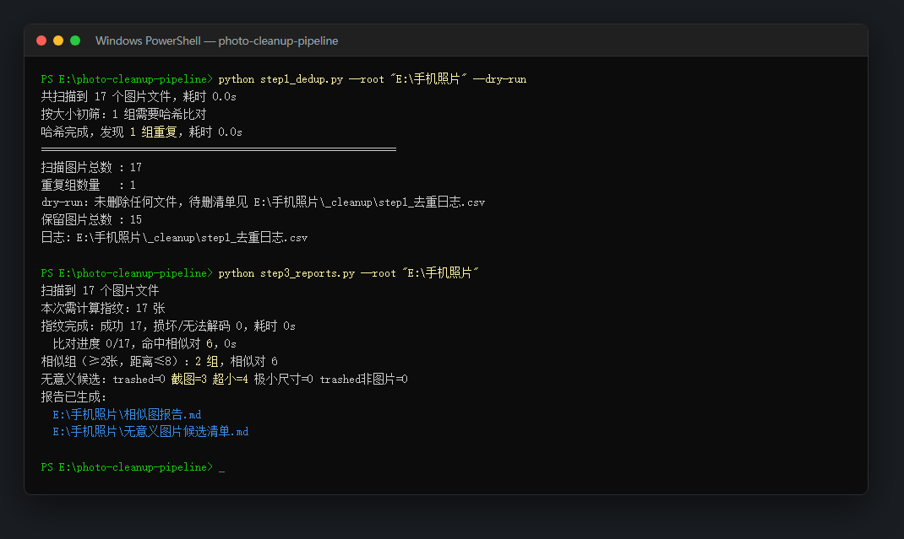
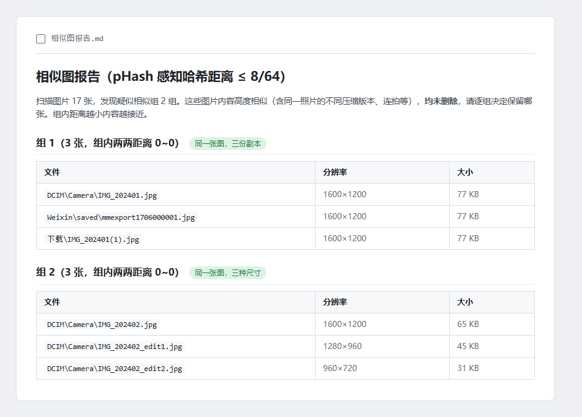

# photo-cleanup-pipeline · 手机照片整理流水线

把「从手机搬出来的几千张杂乱照片」整理干净的七步流水线：**去重 → HEIC 转换 → 相似图报告 → 人工裁决后删除 → 同图版本清理 → 全量重排 → 保存图片细分**。前四步解决「脏」，后三步解决「乱」。每一步都有日志与安全设计，先报告、后动手，绝不静默删你的照片。

> 这个工具来自一次真实整理：两台手机 + 多年导出的照片混在一起，有字节级重复、HEIC 与「假 JPG」、截图表情包缩略图混杂。跑完一遍，混乱的照片目录变成了一份可读的相册。

## 设计原则

1. **能校验的都校验**：HEIC 转 JPG 后重新解码验证完整性与分辨率，通过才删原文件
2. **先报告后删除**：第 3 步只生成 Markdown 报告（相似图组 / 截图 / 超小图候选），第 4 步按你编辑后的清单执行，全程 CSV 日志
3. **可断点续算**：感知哈希每 1000 张存档，中断后重跑自动续
4. **dry-run 常备**：删除类步骤都支持 `--dry-run` 先预演

## 七步流程



*上面是一次真实运行（17 张测试图）：第 1 步按 SHA-256 找出字节级重复，第 3 步算出相似组和无意义候选，两份报告都落在照片根目录。*

前四步处理「脏」：重复、格式、无意义图片。后三步处理「乱」：同图多版本、目录结构、保存图来源。

| 步骤 | 脚本 | 做什么 | 默认行为 |
|---|---|---|---|
| 1 | `step1_dedup.py` | SHA-256 找字节级重复，按优先级（`--prefer` 目录 > 非回收站 > 文件名干净 > 最早）保留一份 | 删除（支持 `--dry-run`） |
| 2 | `step2_convert.py` | HEIC/HEIF → JPG（质量 95，保 EXIF/ICC），逐张校验 | 校验通过才删原 HEIC（支持 `--dry-run`） |
| 2b | `step2b_misnamed_heic.py` | 自动识别「扩展名是 .jpg 但内容是 HEIC」的文件并原地转正 | 原地替换（先写临时文件再 rename） |
| 3 | `step3_reports.py` | pHash（DCT）感知哈希 + 并查集分组，生成相似图报告与无意义图片候选清单 | **不删除任何文件** |
| 4 | `step4_delete_candidates.py` | 按你编辑后的候选清单删除，可按类别（A~E）筛选 | 删除（支持 `--dry-run`） |
| 5 | `step5_same_photo_dedup.py` | 只删「同一张照片的不同版本」（组内距离 ≤ 4 的子簇），每簇留画质最好的一张；连拍的不同瞬间全部保留。清理后重写相似图报告 | 删除（支持 `--dry-run`） |
| 6 | `step6_reorganize.py` | 打散旧目录，按「类型 + 年月」重排为 照片 / 截图 / 表情包 / 手机视频 / 收藏视频 / 其他文件 | **只预演**，`--apply` 才移动 |
| 7 | `step7_split_saved.py` | 细分「保存的图片」：小红书 / 微信 / 抖音 / 聊天图 / 网图 / 导入图 / 其他 | **只预演**，`--apply` 才移动 |

> **两种默认值不是笔误**。第 1/2/2b/4/5 步删的是单个文件、且有 CSV 日志可追溯，所以默认执行；第 6/7 步是整棵目录树的重排，一次动几千个路径，所以默认只预演，必须显式 `--apply`。无论哪一步，先跑预演都不亏。

## 快速开始

第 3 步生成的相似图报告长这样（真实产物，组内两两距离 0 表示同一张图的多个副本）：



```bash
pip install -r requirements.txt

# 建议先复制一份照片目录做试验，确认无误后再对真目录操作

python step1_dedup.py --root "D:\手机照片" --dry-run        # 预演去重
python step1_dedup.py --root "D:\手机照片"                  # 执行去重
python step2_convert.py --root "D:\手机照片" --dry-run      # 转换并校验，但保留原 HEIC
python step2_convert.py --root "D:\手机照片" --limit 20     # 先转 20 张试试
python step2_convert.py --root "D:\手机照片"                # 全量转换（校验通过才删原 HEIC）
python step2b_misnamed_heic.py --root "D:\手机照片" --dry-run
python step3_reports.py --root "D:\手机照片"                # 生成两份报告（这一步耗时最长）
#   → 编辑 生成的「无意义图片候选清单.md」：删掉你不想删的行
python step4_delete_candidates.py --root "D:\手机照片" --dry-run
python step4_delete_candidates.py --root "D:\手机照片"      # 真正删除

# ---- 后三步：处理「乱」----
python step5_same_photo_dedup.py --root "D:\手机照片" --dry-run   # 预演同图版本清理
python step5_same_photo_dedup.py --root "D:\手机照片"             # 执行，并重写相似图报告
python step6_reorganize.py --root "D:\手机照片"                   # 预演：只打印重排统计
python step6_reorganize.py --root "D:\手机照片" --apply           # 执行全量重排
python step7_split_saved.py --root "D:\手机照片"                  # 预演保存图细分
python step7_split_saved.py --root "D:\手机照片" --apply          # 执行
```

所有输出集中在你照片根目录的 `_cleanup/` 下（日志 CSV、清单 JSON、指纹数据），相似图报告与候选清单生成在根目录，方便直接阅读。

## 依赖

- Python 3.10+
- Pillow、pillow-heif（HEIC 解码）、numpy（哈希批量比对）

## 注意

- 第 1、2、2b、4、5 步会删除/替换文件，**务必先 `--dry-run`，并确认你有备份**
- 第 5 步依赖第 3 步的 `_cleanup/step3_指纹数据.json`，跳步会直接报错退出
- 第 5 步只删 pHash 距离 ≤ 4 的子簇，也就是「同一张照片的不同版本」。连拍、同场景多张（距离 5~8）一律保留，只在报告里列出来让你自己看
- 第 6 步默认扫描 `--root` 下所有非分类目录；只想打散某个目录就用 `--source` 指定，可多次给
- 第 7 步只处理 `--root/保存的图片`，换目录用 `--dir`
- `.trashed-` 开头（安卓回收站残留）与 `Screenshot/截图` 文件名等规则可在脚本头部调整
- pHash 阈值可在脚本顶部调整：第 3 步的 `THRESHOLD`、第 5 步的 `GROUP_T` / `SAME_T`，值越大分组越宽松
- 移动类步骤（6、7）的 CSV 日志记录「原路径 → 新路径」，可以照着日志反向还原

## License

MIT
